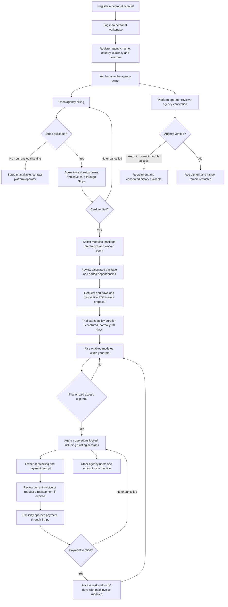
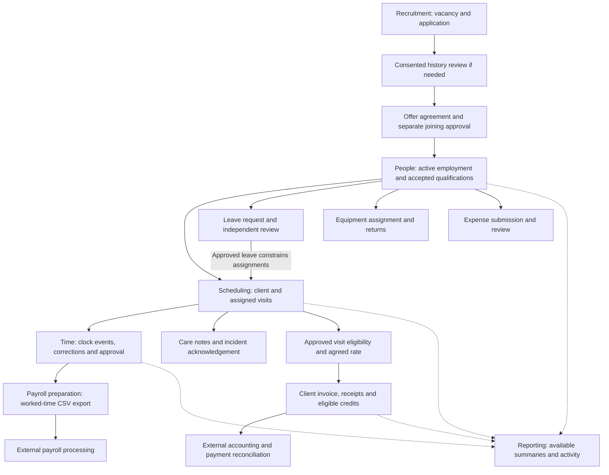

# CareSys Agency Registration and Module Workflow 27 October 2026

Audience: agency owner or agent managing an agency. This guide describes the current application, with the intended Stripe journey clearly distinguished from what can run locally today.

**Current restriction:** Stripe setup is deliberately disabled. A new agency cannot complete real card setup or activate its normal trial until Stripe is configured and validated. Simulated test results are not real payments. Email verification and recovery delivery are also pending production work.

## Registration and access flow

Agency verification and billing are separate gates. Operator verification does not save a card, start a trial or grant a paid subscription. A trial does not verify an agency. Suspension blocks access.

## Owner onboarding checklist

1. **Create your personal account and log in.** Your personal records remain separate from agency records.
2. **Register the agency.** Enter its name, country, currency and timezone. The creating account becomes owner; the agency initially has no operational modules.
3. **Complete billing setup when available.** Confirm the terms and use Stripe hosted card setup. CareSys receives a verification result and card summary; card setup does not charge a subscription fee.
4. **Choose modules and expected workers.** Use the module checkboxes and package selector. Pricing compares available packages and required add-ons; the preferred package is not a guarantee that it will be the calculated lowest-cost package.
5. **Review and request the invoice proposal.** Check the module descriptions, dependencies, worker allowance and total. Download the PDF. For a new managed subscription, verified card setup is required first.
6. **Begin the free trial.** The first selected invoice starts the trial and enables its effective modules. The start is not the original registration date. The default is 30 days; the platform administrator can change policy for future starts. Selecting another invoice does not restart the trial.
7. **Arrange agency verification.** The platform operator records the review decision. Recruitment and consented history require verified agency status plus current access and their modules.
8. **Add administrative colleagues.** Reuse their existing personal account, including an account already belonging to another agency. Ask them to register only if they have no account, then assign an appropriate owner, recruiter, scheduler, supervisor or finance role using their account email. Caregiver membership comes through the employment joining workflow, not this administrative role form.
9. **Prepare people, client and operational records.** Use the module sequence below. Access depends on role, enabled modules, agency status and current trial or paid period.
10. **Review the end date and pay when due.** No subscription deduction occurs during the free period. Expiry locks operational access; only an owner can approve the payment needed to resume. The current implementation buys 30 days per verified payment and does not automatically renew.

## Using all 13 modules

The order below is a practical sequence, not a requirement to purchase every module. Equipment, leave and expenses are parallel activities. People administration is the base module; history adds recruitment, scheduling adds people and care, and payroll adds people and time automatically.

| Step | Module | Agency action and hand-off | Result and important condition |
| --- | --- | --- | --- |
| 1 | Recruitment and applications | Publish vacancies, search eligible published profiles, send invitations, review applications and progress candidates. | Candidate shortlist. Requires verified agency and current recruitment access. Invitations are recorded; actual external message delivery remains pending. |
| 2 | Consented career history | Request selected career history for a stated purpose. The caregiver chooses what to share and decides whether to grant access. | View only the permitted versions while consent remains valid. No consent or withdrawn/expired consent means no access. |
| 3 | Offers and joining | Prepare the offer version; agency and candidate separately record agreement; candidate separately authorizes joining. Activate employment when the effective date and required conditions permit. | Active employment and caregiver agency membership. Agreement and joining are separate decisions; a future offer does not mean immediate employment. |
| 4 | People administration | Review the employee/team register, qualifications and administrative roles. Maintain the agency relationship and manage departure when appropriate. | People available for agency operations. Full HR document management and bulk import remain pending. |
| 5 | Scheduling and visits | Create client records and instructions, create visits, assign eligible caregivers and check timezones, overlaps, leave and qualifications. | Assigned visits. Recurring visits and full rescheduling/availability optimization remain pending. |
| 6 | Time and attendance | Caregiver records online clock and break events; reviewer examines worked time, corrections and approvals. | Approved worked-time records for payroll preparation. Offline and native visit capture are pending. |
| 7 | Leave management | Caregiver submits leave; an independent reviewer approves or rejects; maintain balances and process cancellations. | Approved leave feeds scheduling checks. Accrual engines, holiday rules and paid-leave payroll allocation remain pending. |
| 8 | Care notes and incidents | Record visit-related notes and incidents; reviewer acknowledges incidents. | Traceable care records. Full care plans, visit task lists, amendments and escalation workflows remain pending. |
| 9 | Equipment and custody | Register equipment, assign custody, record return condition and review history. | Current holder and equipment history. Advanced inventory, expected-return alerts and scheduled maintenance remain pending. |
| 10 | Expenses | Worker submits an expense; another authorized person reviews it; record reimbursement evidence. | Reviewed expense and reimbursement record. This does not transfer money; receipt uploads and provider payouts remain pending. |
| 11 | Payroll preparation and exports | Map employee provider identifiers, select approved worked time, create the export snapshot and download CSV. | Immutable export and locked source allocation for external processing. CareSys does not calculate statutory payroll or pay employees. |
| 12 | Invoices and receipts | Set agreed rates, invoice eligible approved whole visits, record partial/full receipts and review eligible unpaid invoice credits. | Client billing records. This is separate from the CareSys subscription invoice; it is not a full accounting ledger or bank collection integration. |
| 13 | Reporting | Review role- and module-scoped summaries, counts and recent activity throughout the workflow. | Basic operational visibility. Detailed reporting, configurable exports and scheduled report delivery remain pending. |

## Operational hand-off diagram

External payroll processing and accounting reconciliation are work outside the implemented CareSys integrations. Approved expenses and leave are not automatically included in the current worked-time payroll export.

## Trial expiry and payment checklist

| Event | Agency owner | Other agency users |
| --- | --- | --- |
| Card not verified or trial modules not selected | Can access billing setup; operational agency access remains locked. | Cannot use locked agency operations. |
| Active trial | Uses enabled modules within permissions; can download the invoice proposal. | Uses assigned agency functions within permissions. |
| Exact trial end timestamp reached | Billing prompt remains available; must review invoice and explicitly approve payment. | Account locked notice directs them to the owner. |
| Payment cancelled, failed or not verified | Access stays locked; return to billing to resolve. | Account remains locked. |
| Payment verified for the current invoice | Invoice marked paid and 30 days of access granted. | Agency access resumes within assigned permissions. |
| Paid period ends | Another owner-approved payment is required; no automatic renewal. | Agency operations lock again until resolved. |

Locking agency operations does not delete personal caregiver records or transfer their ownership to an agency. Billing access is owner-only. Existing commercially active legacy agreements follow their recorded entitlement arrangements rather than automatically being enrolled in this new trial journey.

## Part time work across agencies

Caregivers can activate separate agreed part-time contracts with multiple agencies using the same personal account. Scheduling checks recorded shifts and approved leave across agencies, offers free-time choices, and supports caregiver-approved replacement of eligible future shifts. Other agencies' private shift records remain hidden from schedulers. See [the multi agency shift workflow](CareSys_Multi_Agency_Shift_Workflow_27_October_2026.md) for the approval and coverage process.

## Mobile use

The current native client supports pairing and agency billing. Pair the device using a short-lived code, review and approve it in the signed-in web application, then use permitted billing features. Native recruitment, visits, clocking, leave, care, equipment and expense screens are pending; the complete operational journey above currently uses the web application. The isolated API enforces its own authentication and agency permissions.

## Source and review basis

Reviewed against the current AdministrationService, AgencyAccessService, TrialBillingService, SubscriptionQuote, SubscriptionPricing, Workspace permissions, route definitions and the dated module status report. This is a workflow guide as of 27 October 2026, not a claim that pending capabilities are delivered. No application, website or payment configuration changes are made by this document.
