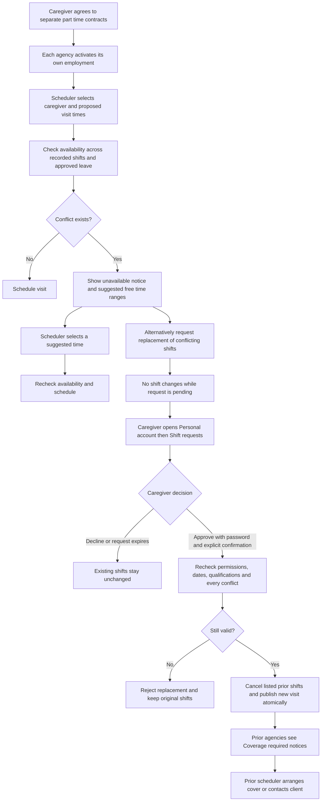

# CareSys Part Time Multi Agency Shift Workflow 27 October 2026

## What is implemented

One existing personal account can hold active part-time employment with more than one agency. Each employment must have its own agreed `part_time` contract, joining approval and activation. An existing full-time or unclassified legacy employment still requires review rather than automatically allowing another active employment. Duplicate active employment within the same agency is rejected. Leaving one agency preserves the other agency relationship.

Agency records, contracts, pay, leave balances and payroll remain separate. A scheduler sees whether the caregiver is unavailable and alternative time choices, not the other agency's identity, client, address, service or visit reference. The caregiver can see their own affected agency names and shift times when deciding.

## Scheduler and caregiver journey

1. In the agency workspace, open **Scheduling** and complete the client, caregiver, start, end and service fields.
2. Select **Check availability and suggest times**, then **Continue**. The system checks recorded commitments across all agencies in UTC and shows choices in the requesting agency timezone.
3. Choose **Schedule this suggested time** to recheck and save that time. Suggestions are not reservations. They do not enforce travel time, declared working hours or legal work limits; confirm those separately. The search finds up to three gaps of the requested duration within seven days after the requested start.
4. If keeping the requested time is necessary, select **Ask caregiver to replace conflicting shifts**. This is a request, not an agency override. The original shifts remain published.
5. The caregiver signs in using the same personal account and opens **Shift requests**. They see the proposed agency, local times, service, expiry and every prior shift that would be cancelled. Prior shift times are explicitly labelled UTC.
6. To decline, choose **Decline and keep my current shifts**. No password or cancellation confirmation is needed.
7. To approve, choose **Approve replacement and cancel listed shifts**, enter the current account password and explicitly confirm cancellation of every listed prior shift.
8. Approval rechecks the exact conflict set and record versions, employment, requesting scheduler's current permissions, agency access and required qualifications. If anything relevant changed, the request cannot replace shifts; ask for a fresh request.
9. A successful approval cancels all listed prior shifts and publishes the proposed visit in one transaction. If scheduling fails, the cancellations roll back too.
10. Each affected prior agency sees a **Coverage required** entry on its Scheduling page for its own cancelled visit. It must arrange another caregiver or contact its client. The requesting agency sees the decision and resulting visit reference under **Replacement requests**.

## Boundaries

- Only future published shifts with no clock events can be replaced. In-progress, completed, past and recorded-time shifts cannot be bumped.
- Approved leave, including leave awaiting cancellation approval, cannot be overridden through a shift request.
- Requests expire at the earlier of 24 hours after creation or the proposed shift start. Pending requests do not reserve a slot. Expired requests display as expired to the caregiver; an agency request row retains its stored decision and separately shows its expiry timestamp.
- A caregiver cannot clock into another agency's visit while an existing work session remains in progress.
- Adjacent shifts are permitted when one ends exactly when another begins. Overnight shifts are supported, up to 24 hours. Travel buffers are not implemented.
- Original shifts are cancelled, not deleted. Their agencies receive audit records and durable coverage events. The caregiver does not disclose the replacement agency or client to the displaced agency.
- Notices are available inside CareSys and queued in the outbox. Actual email, SMS and push delivery remain pending provider integrations. Schedulers should contact the caregiver directly to ask them to review the request.
- This feature is implemented in the web application and session/bearer web services. The current native client remains focused on pairing and billing; native scheduling screens are not added by this change.
- Stripe remains disabled and the website is unchanged.

## Validation

The acceptance tests exercise two part-time contract activations, full-time restrictions, offboarding isolation, cross-agency overlaps, timezone conversion, touching shifts, private alternatives, caregiver-only decisions, password/confirmation checks, decline, expiry, stale schedules, permission revocation, qualification-failure rollback, approved leave, started shifts, multiple conflicts and cross-agency clock protection. A separate two-process MySQL race test requires exactly one successful booking when different agencies attempt overlapping visits for the same person.

Local browser evidence in `Test/MultiAgency` verifies the Scheduling availability form and suggestions at desktop and mobile widths, plus the personal caregiver request page. These browser captures show availability and the empty request state; the replacement decision paths are covered by automated database tests.

This guide supersedes the earlier single-active-employment limitation described in the dated module review. It does not mark advanced scheduling, travel planning or the entire native care application complete.
