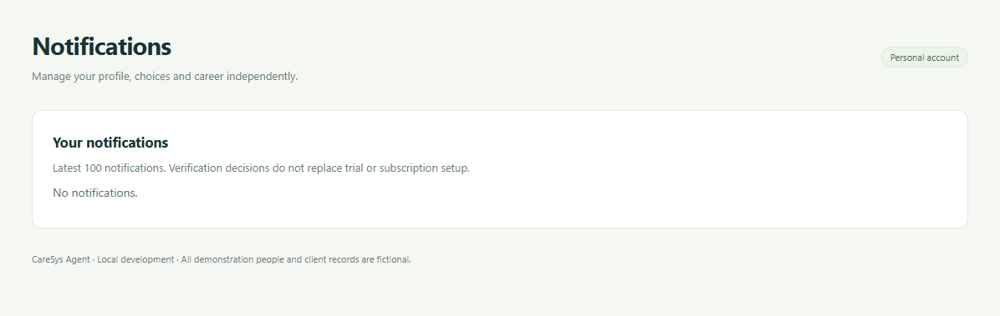
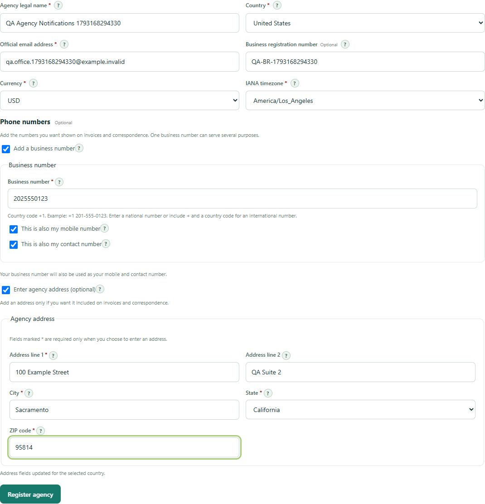
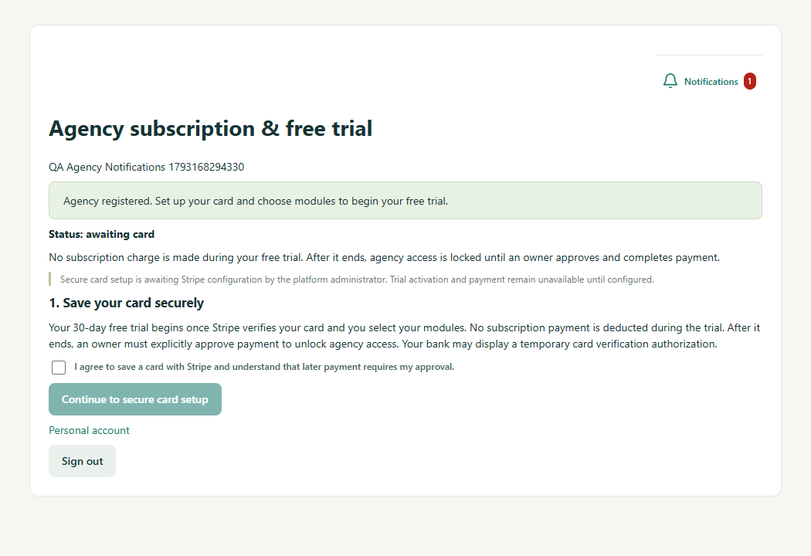
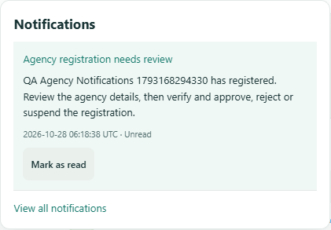
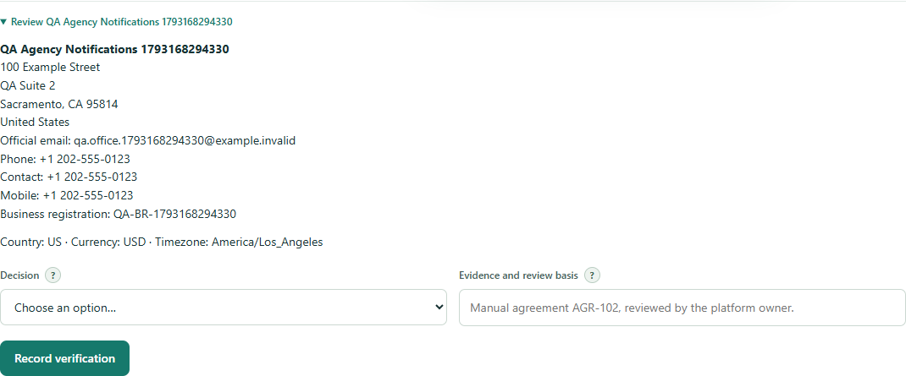
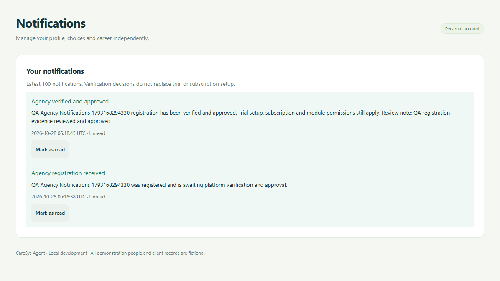
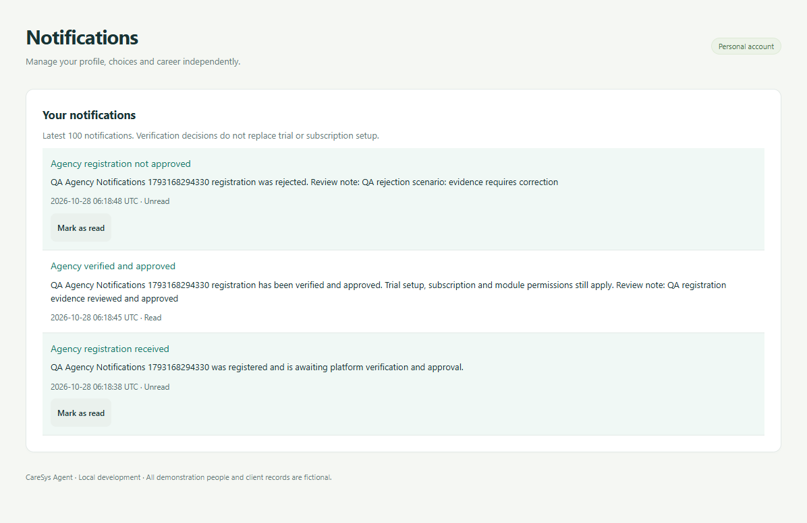
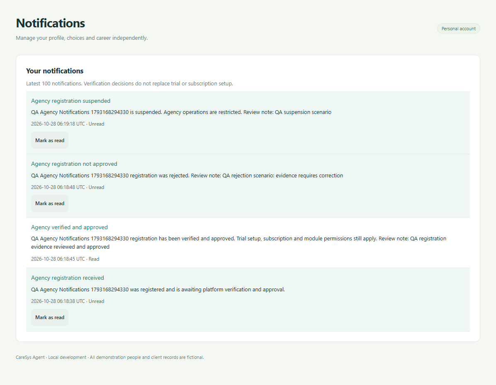
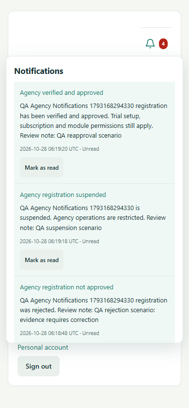

# Register and Agency Screenshot Evidence 27 October 2026

All agency and account details shown below are disposable fictional test data.

### 1 New account empty notification inbox

### 2 Agency registration with shared business/mobile/contact number and opted-in address

### 3 Registration receipt and notification menu available while billing is locked

### 4 Platform administrator review request

### 5 Administrator reviews agency contact and address details before deciding

### 6 Owner receives verified and approved decision

### 7 Owner receives rejection and review note

### 8 Owner can read suspension decision in the personal workspace

### 9 Mobile notification menu shows status history within the viewport

