# New agency account: free-trial and payment scenario

**Result: PASS.** Tested 2026-10-27T21:29:02.239Z through 2026-10-27T21:30:55.328Z (UTC), 27 October 2026 in America/Los_Angeles. The run contains 20 passing scenario checks. Additional regression evidence: **50 backend tests / 230 assertions** and **5 mobile client tests**, all passing.

## Finding corrected during this test

The expired-owner payment button was initially enabled while Stripe was unconfigured. It is now disabled, matching the server and mobile client. No charge or access bypass occurred. See [findings and correction](findings.md) and [the original failing observation](F01-observation.json). The final passing run below verifies the correction.

## Scope and limits

New owner and member accounts were registered through the actual application registration UI. The owner registered a new agency and granted the new member a scheduler role. Browser flows ran in Microsoft Edge through Playwright on the local HTTPS application. Mobile web-service checks used separate, scoped bearer credentials against the isolated API host. These are API checks, not screenshots from a physical native phone.

**Stripe remained disabled throughout. No real card was entered, no Stripe API call was made and no money was charged.** To continue beyond the real card prerequisite, the CLI-only support runner injected simulated provider responses for this specifically identified synthetic agency. Screenshots of simulated stages carry a visible evidence banner. The trial clock was accelerated for this agency only; we did not wait 30 calendar days or change the global policy.

## Test accounts

| Item | Value |
|---|---|
| Agency | Test Trial 1793136411741.dbdadf (SIMULATED) |
| Agency reference | f7069cf5a18925d7ca01987c87bde5bb |
| Owner login email | trial.owner.1793136192611.c31eb7@example.invalid |
| Owner account name | trial.owner.fdddca0b |
| Member login email | trial.member.1793136192611.c31eb7@example.invalid |
| Member account name | trial.member.8e40af04 |
| Member role | Scheduler |
| Final agency state | Awaiting card; Stripe disabled |

Login details are retained locally in the ignored **Account_Access.local.txt** file inside this folder. The CLI runner also uses the ignored **session.local.json** file. It contains generated test passwords and must not be committed or shared. The accounts remain available for inspection at https://localhost:8444/login. Simulated paid access and card details were reset after testing, and test bearer tokens were revoked. The agency, member role and issued test proposal remain.

## Results

| # | Check | Result | Observed behavior |
|---:|---|---|---|
| 1 | New owner account registered through UI (resumed test) | PASS | trial.owner.1793136192611.c31eb7@example.invalid |
| 2 | New member account registered through UI (resumed test) | PASS | trial.member.1793136192611.c31eb7@example.invalid |
| 3 | New agency is blocked pending a card; Stripe stays disabled | PASS | awaiting_card; secure setup button disabled |
| 4 | Invoice/trial cannot be created before verified card | PASS | Rejected by the server; awaiting_card remains |
| 5 | Module selection starts a 30-day free trial and issues invoice | PASS | USD 69/month: custom platform 29 + scheduling 25 + care dependency 15 |
| 6 | Owner can download professional module-description invoice | PASS | application/pdf, HTTP 200 |
| 7 | Exact trial expiry boundary and no payment prompt during trial | PASS | {"second_before":false,"at_deadline":true,"trial_days":30} |
| 8 | Owner grants new member agency access | PASS | Scheduler role; no billing authority |
| 9 | Mobile bearer API reports active trial | PASS | HTTP 200; state trial |
| 10 | Existing owner session is blocked at trial expiry | PASS | Dashboard redirects to billing; owner payment prompt shown |
| 11 | Fresh owner login after expiry opens billing | PASS | Redirected to agency billing |
| 12 | Existing and fresh member sessions show lock notice only | PASS | Agency locked; owner-contact notice; no billing controls |
| 13 | Mobile API locks agency operations and hides billing from members | PASS | Owner operation 402; member status minimal; member PDF 403 |
| 14 | Real Stripe configuration remains disabled | PASS | Browser API stripe_configured=false; no keys changed |
| 15 | SIMULATED failed payment does not unlock access | PASS | 409; agency remains locked |
| 16 | SIMULATED wrong payment amount does not unlock access | PASS | 409; agency remains locked |
| 17 | SIMULATED successful verification unlocks once for 30 days | PASS | paid; duplicate verification does not extend period |
| 18 | Owner and member access are restored after simulated success | PASS | Both dashboards available |
| 19 | Restore original no-card state after simulation | PASS | awaiting_card; fake checkouts removed; real Stripe remains disabled; accounts and issued test invoice retained |
| 20 | Platform administrator can view the configurable free-day policy | PASS | Current default 30 days; choices 1–365; global setting left unchanged. Isolated backend tests cover policy changes. |

## Price and invoice

Selected modules: **People administration** and **Scheduling & visits**. Scheduling automatically adds **Care notes & incidents** as a dependency. Coverage: 10 workers. The lowest price was the custom platform: **USD 29 + USD 25 + USD 15 = USD 69 per month before tax**. This is a future paid-service proposal, not a charge for the free trial.

Invoice: **CSI-20261027-5B028FE53250**. [Download the captured trial invoice](trial-invoice.pdf). The PDF includes module descriptions, selected/dependency labels, free-period terms and the original 30-day trial deadline. Original trial timestamps: 2026-10-27 21:29:54 UTC to 2026-11-26 21:29:54 UTC. The test subsequently moved the agency's trial window into the past to exercise expiry; the immutable invoice snapshot deliberately preserves its original issue-time terms.

## Payment and time simulation

The simulator used the same TrialBillingService as the application, injecting a fake StripeGateway only from the CLI-only Test/support.php runner. Normal browser/mobile requests continued to use the disabled real provider. No public test-payment endpoint or application bypass was introduced.

The fake setup response represented a verified card. Failed/unpaid and wrong-amount payment responses were rejected with domain status 409 while access remained locked. A matching simulated paid response activated 30 days of access, and repeating verification did not extend the deadline. The actual browser then demonstrated owner and member dashboard access. Simulated paid access was subsequently removed and the original awaiting-card state restored. Fake checkout records were removed; test audit events identify the simulation and reset. The retained proposal is issued/unpaid.

The exact boundary check evaluated the server's access policy one second before and exactly at the saved deadline. Access was allowed before, and locked at the deadline. Global free-trial policy was not changed. The accompanying backend regression tests also verify a changed policy is snapshotted for a new trial and cannot alter an existing trial deadline.

## Evidence and reproduction

- [Structured scenario results](results.json)
- [Backend regression output](backend-tests.txt)
- [Mobile client regression output](mobile-tests.txt)
- Scenario runner: run-scenario.cjs
- CLI-only, agency-scoped simulator and reset: support.php
- Report generator: write-report.cjs

From the repository root, run the scenario with Node and Playwright available through CARESYS_NODE_MODULES. A new run creates new synthetic accounts; CARESYS_TEST_RESUME=1 can reuse accounts from the local credentials file after an interrupted setup. The support script refuses non-synthetic owner emails/agencies and requires real Stripe configuration to remain disabled.

Initial test-harness setup was corrected to use allowed account names (letters, numbers and periods) and select country/currency/timezone through their dropdown controls. Product validation rules were unchanged. The final successful run is the source of the results above.

## Screenshots

### 01 new owner registration

New owner registration through the actual UI; password fields masked.

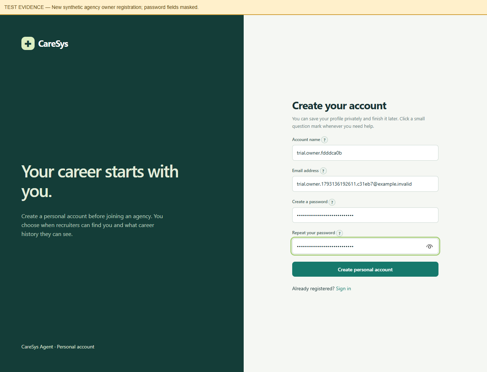

### 02 agency registration

New agency registration through the actual application form.

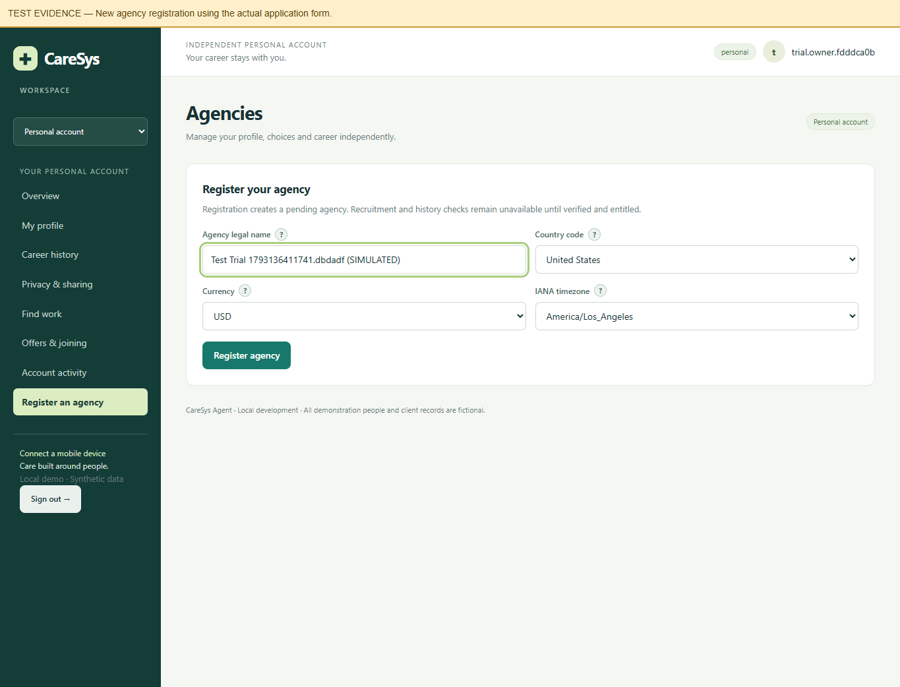

### 03 stripe disabled card required

Actual UI: Stripe remains disabled; no card entered and trial cannot start.

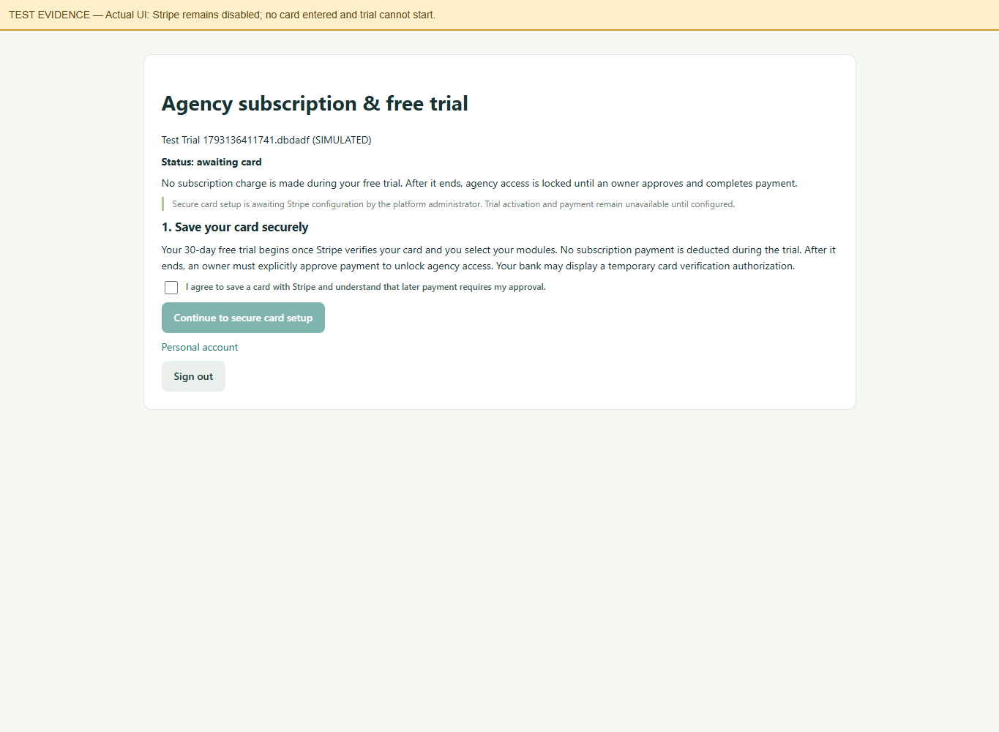

### 04 simulated card verified

SIMULATED card verification through CLI-only fake provider; no Stripe API or real card.

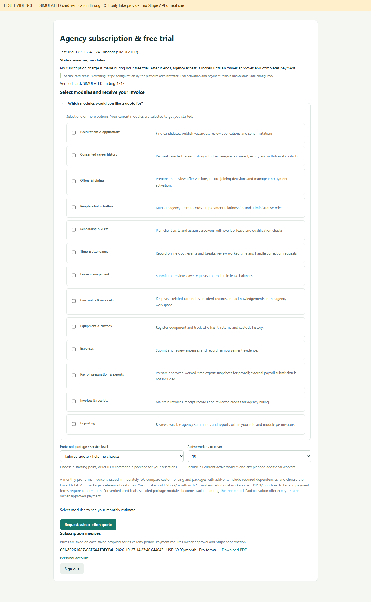

### 05 module selection estimate

Select people and scheduling; care dependency included; USD 69/month before tax.

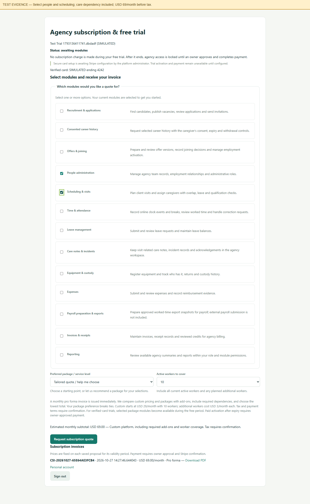

### 06 free trial active

Actual trial gate and invoice after SIMULATED card verification.

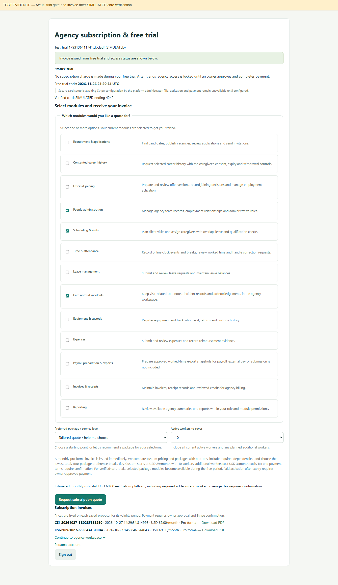

### 07 member access during trial

New member can access the selected agency during the simulated-card free trial.

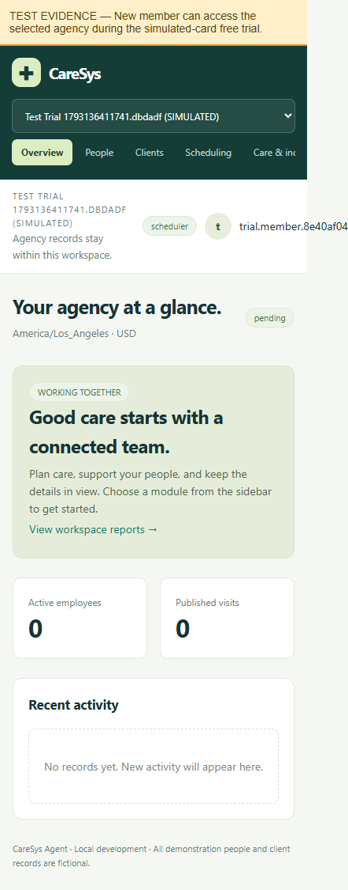

### 08 owner expired payment prompt

SIMULATED elapsed 30 days. Owner gets payment prompt; real Stripe payment is still disabled.

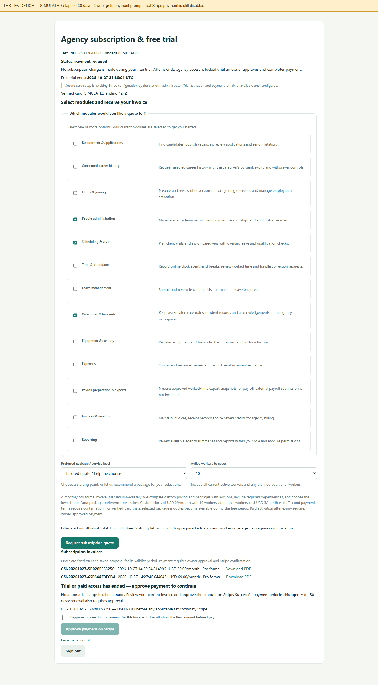

### 09 owner login after expiry

Fresh owner login after simulated expiry opens billing only.

### 10 member login locked mobile

Fresh member login: generic locked notice, no card details, invoice or payment controls.

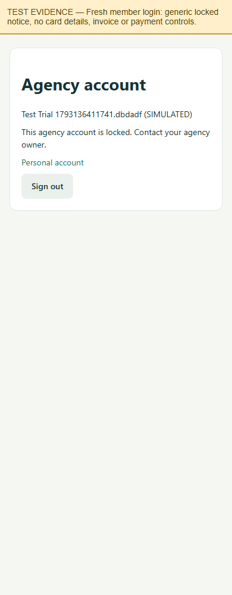

### 11 simulated failed payment stays locked

SIMULATED unpaid provider response rejected; agency remains locked.

### 12 simulated payment approved

SIMULATED paid state only — no real card payment or Stripe request.

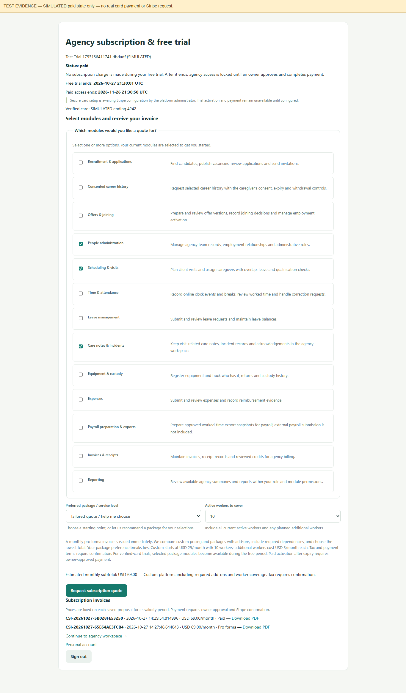

### 13 access restored after simulated payment

Agency dashboard available after simulated successful provider verification.

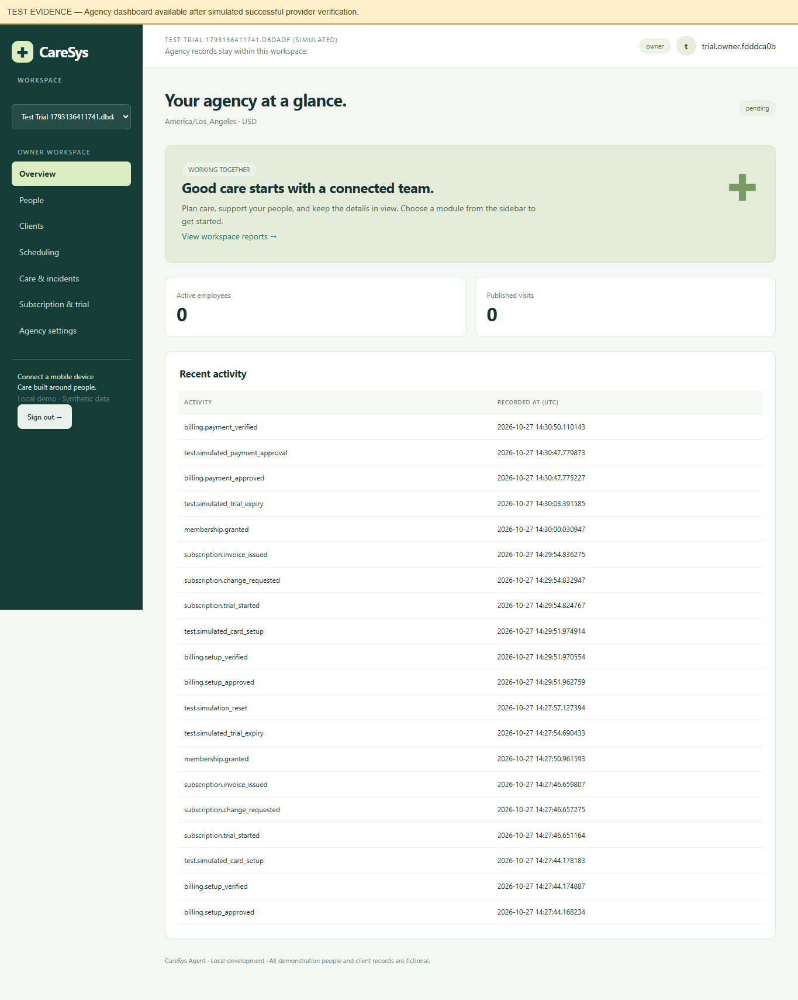

### 14 final state stripe disabled

Final retained test account: awaiting card; Stripe disabled; simulated paid access removed.

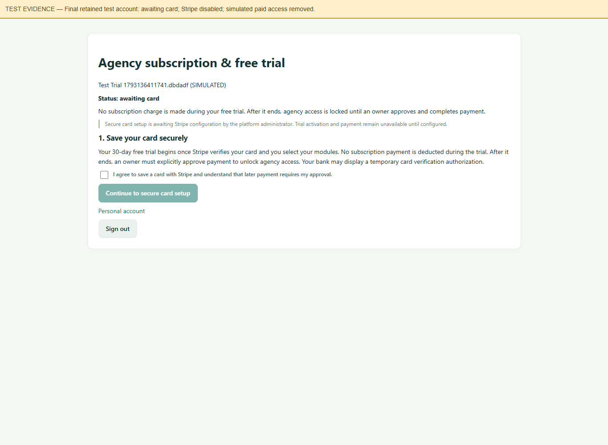

### 15 invoice pdf preview

Captured original invoice: selected modules, care dependency, USD 69/month proposal and 30-day free-trial terms.

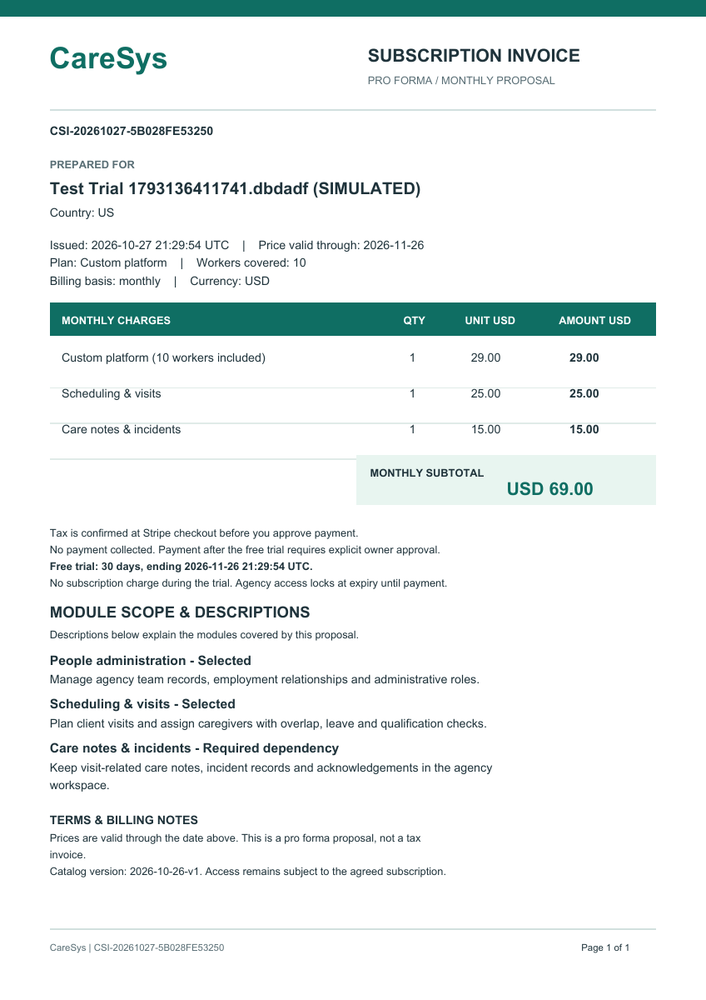

### 16 platform trial policy

Platform administrator policy screen; current global default remains 30 days.

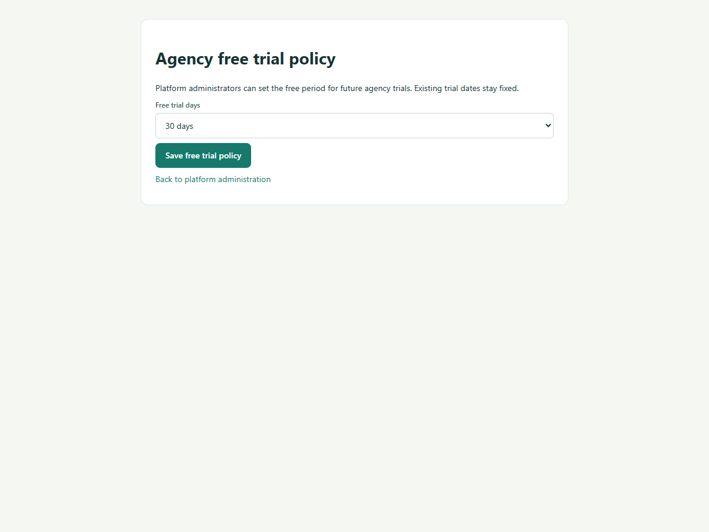
